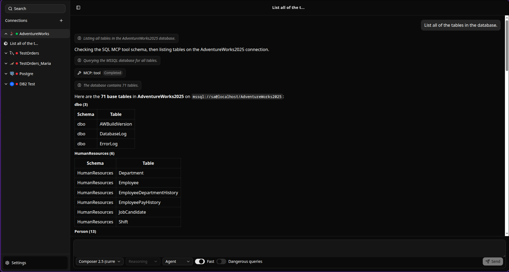
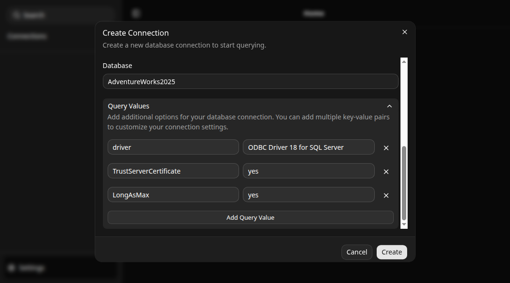
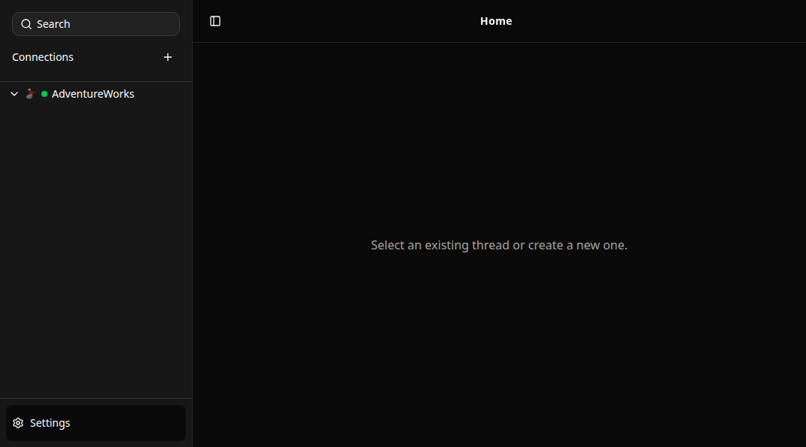
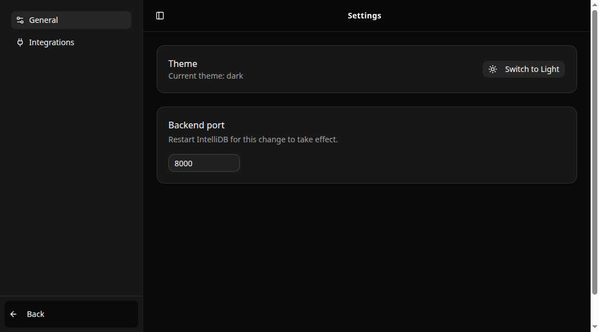
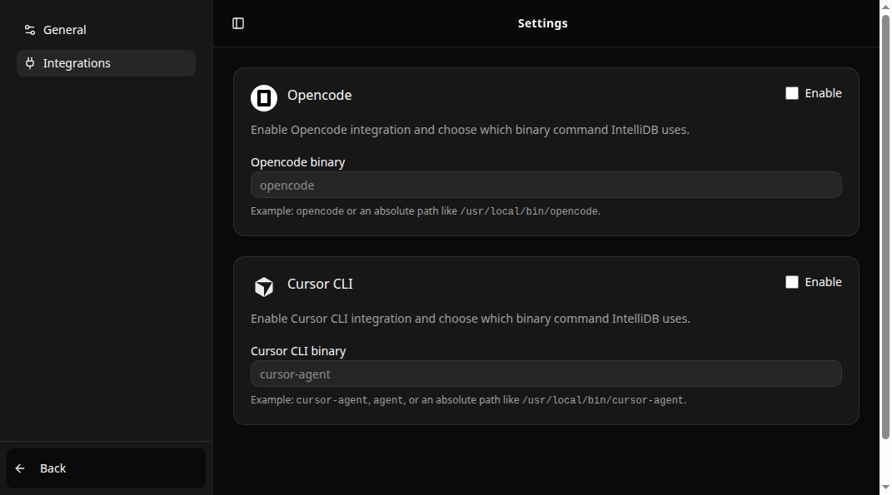

# IntelliDB

<p align="center">
  
</p>

**IntelliDB is a new vision of database management tools — Claude Code and Codex, but for databases.**

Tools like Claude Code and Codex are designed to work around projects. You pick a folder, and you start working. Sure, you could add an MCP and work with a database, but you're working with an application whose UX is not designed around database work.

IntelliDB is a tool i imagined to have a similar workflow like Claude Code and Codex, but instead of working on source code, it is working with databases. A backend and an MCP server that can work with multiple databases at once (including different RDBMS'), an interface that is designed for this use-case, a safety switch to prevent potential chaos, and (hopefully in the future) an object browser, so you can look at the state of the database directly from the app.

Like Claude Code and Codex that decreased the need for a code editor, IntelliDB aims to replace the need for heavy tools like DBeaver, SSMS and such.

## Features

- **Chat with your database.** Every connection gets chat threads. Ask questions, request analyses, and get real answers backed by real queries — not guesses.
- **Real agent, real tools.** The agent runs as a local CLI subprocess (Cursor CLI or OpenCode) speaking the, with an mcp tool wired directly to your connection. You watch it think, call tools, and plan in a live activity feed.
- **Dangerous queries gate.** A dedicated switch for destructive operations, so `DROP` and friends never sneak through a casual prompt.
- **Multi-engine connections.** SQL Server, MySQL, MariaDB, PostgreSQL and IBM DB2 (via SQLAlchemy), with custom SQLAlchemy connection-query parameters (driver, `TrustServerCertificate`, …) per connection.
- **Credentials stay local.** Connections are stored in a local SQLite config DB; passwords are kept in the OS keyring (gnome-keyring/KWallet/Windows credential store). No cloud, no accounts.
- **Connection lifecycle at a glance.** Status dots show Disconnected / Connecting / Connected; connect, disconnect, edit and delete from a context menu.
- **Model choice.** Pick the model the agent works with — Composer, GPT, Claude, Gemini, Grok and more — straight from the chat footer.
- **Chat management.** Search, rename, delete, and lazily-loaded thread lists; history and session IDs persist across restarts in the local config DB.
- **Dark and light themes.** The whole UI (React 19 + Tailwind 4 + shadcn/Radix) respects your theme, switchable in Settings.

## Screenshots

| | |
|---|---|
|  |  |
| *Create a connection — any SQLAlchemy-supported engine* | *Home — connections live in the sidebar with status dots* |
|  |  |
| *Settings — theme and preferences* | *Settings — enable Cursor CLI or OpenCode as the agent* |

## Architecture

One desktop app, three cooperating processes:

```
┌──────────────────────────────────────────────────────────────┐
│  Electron app                                                │
│                                                              │
│  Renderer (React 19 + TanStack Router/Form + Zustand)        │
│      │  typed IPC bridge (preload)                           │
│  Main process — config DB (~/.intellidb/config.db),          │
│      │          agent host (ACP), credential keyring         │
│      │  spawns                                               │
│  sqlmcp backend — bundled Python/FastMCP server on           │
│                   127.0.0.1:8000 (MCP + REST)                │
└──────────────────────────────────────────────────────────────┘
          │                                │
          ▼                                ▼
   Agent CLI subprocess              Your database server
   (cursor-agent / opencode)         (SQL Server, MySQL, …)
          │                                ▲
          └──── MCP: execute_sql ──────────┘
```

- **Renderer** — the chat UI: threads, activity feed (thoughts, tool calls, plans, messages), composer with model/reasoning/mode pickers, connection and settings dialogs.
- **Main process** (`src/main.ts`) — owns the config DB, settings, connection CRUD and credentials; spawns and health-checks the backend; hosts the **agent host** (`src/lib/agentHost.ts`), which connects agent sessions over ACP, streams activity to the renderer over IPC, persists messages and session IDs, and routes permission requests to the UI.
- **Backend** (`src/backend/sqlmcp.bin`) — a compiled [FastMCP](https://gofastmcp.com) server exposing an `execute_sql` MCP tool plus `GET /connections`, `POST /connect_db`, `DELETE /close_db`. Built from `sqlmcp/` with Nuitka; each DB connection is a SQLAlchemy engine held server-side.

## Project structure

```
desktop/intellidb/
├── src/
│   ├── main.ts                  # Electron main process: window, IPC, config DB, backend lifecycle
│   ├── preload.ts               # Context-isolated IPC bridge (settings:*, connections:*, agent:*)
│   ├── routes/                  # TanStack Router routes: /, /settings/general, /settings/integrations
│   ├── components/
│   │   ├── index/               # Feature components: ChatView, ConnectionDialog, activity entries…
│   │   └── ui/                  # shadcn/Radix primitives
│   ├── acp/                     # ACP adapters: ACPClient, CursorClient, OpenCodeClient
│   ├── lib/agentHost.ts         # Agent lifecycle, sessions, permissions, activity bridge
│   ├── stores/                  # Zustand stores (chats, settings, backend connection, …)
│   ├── models/                  # Data models (Chat, Message, Settings)
│   ├── interfaces/              # Shared type contracts (ACP handlers)
│   └── backend/                 # Drop-in target for the compiled sqlmcp.bin
├── sqlmcp/                      # Python MCP backend: sqlmcp.py, helpers, Nuitka build (compile.sh)
├── docs/images/                 # Screenshots used by this README
├── .cursor/skills/verify-intellidb/   # CDP-driven verification harness (launch/drive/doctor/cleanup)
├── forge.config.ts              # Electron Forge packaging config
└── vite.*.config.mts            # Vite configs for main / preload / renderer bundles
```

## Getting started

### Prerequisites

- Node.js ≥ 22 (or [Bun](https://bun.sh)) and npm
- A database server to connect to (SQL Server, MySQL/MariaDB, PostgreSQL, or DB2, Oracle will be added shortly)

### Run in development

```bash
bun install
bun run start        # electron-forge start — builds main/preload/renderer with Vite
```

The app starts its bundled backend automatically (`src/backend/sqlmcp.bin` → `127.0.0.1:8000`). If you change the Python backend, rebuild the binary with `sqlmcp/compile.sh` and copy it into `src/backend/`.

### Connect a database

1. Click **+** next to *Connections* in the sidebar.
2. Name the connection, pick the DBMS, and fill in host, credentials and database.
3. Optionally add SQLAlchemy query parameters (e.g. `driver: ODBC Driver 18 for SQL Server`, `TrustServerCertificate: yes`).
4. Right-click the connection → **Connect** — the dot turns green when the backend holds a live engine.

### Pick your agent

Open **Settings → Integrations** and enable **Cursor CLI** or **OpenCode** (set the binary path if it isn't on `PATH`). Then open a chat, choose a model in the footer, and start asking.